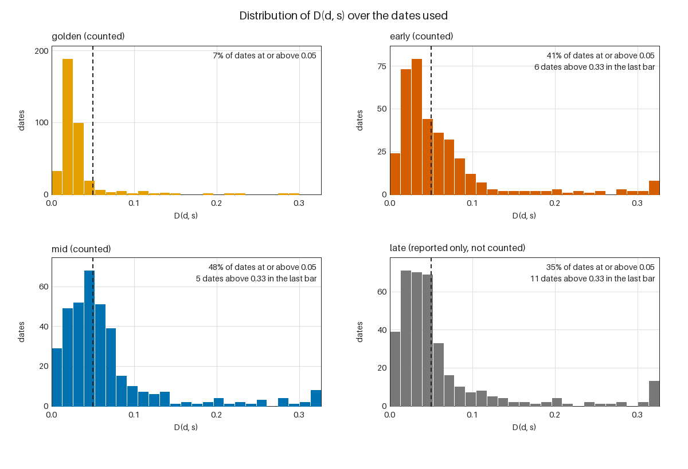
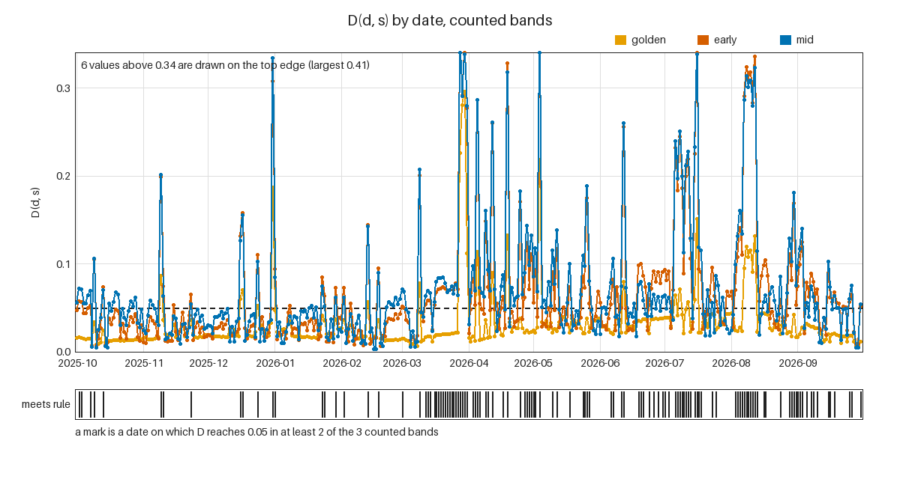
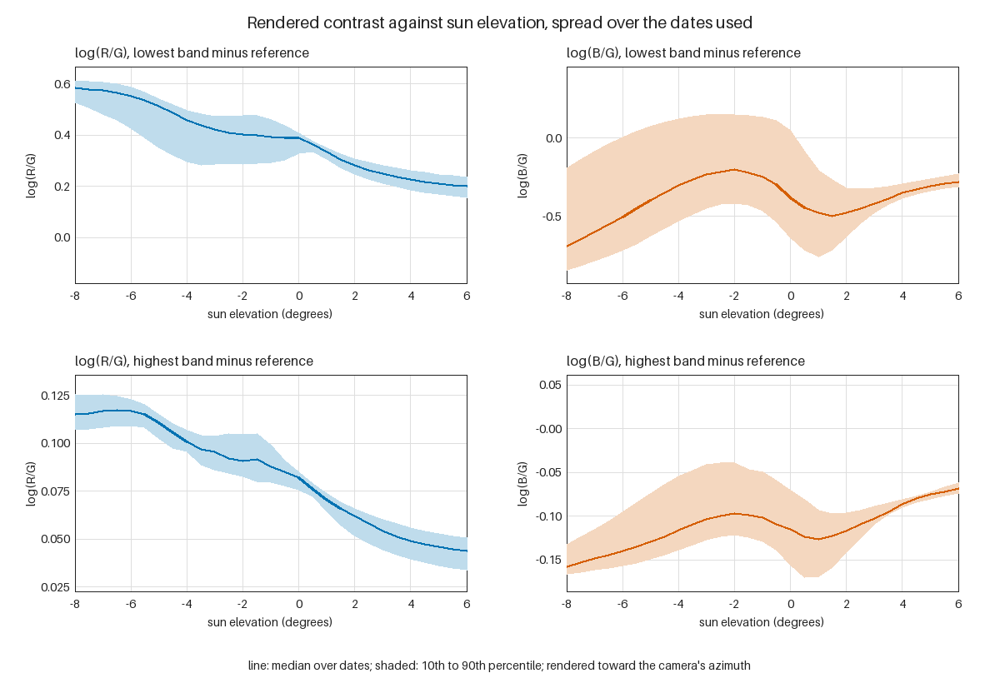

# G0 with renderer v1: does the rendered curve vary enough to measure?

The spread study of issue #10 re-run with renderer v1 (issue #35) over the evenings 2025-10-01 to 2026-09-30: each date's archived atmosphere, as the v0 run recorded it, re-rendered for WHTM1's frozen geometry. The criterion and its verdict rule are G0's and are unchanged. The v0 result is in [the v0 report](../report.md).

## Verdict

**PASS** against the pre-registered criterion.

**Read this PASS in renderer-v1 units.** D(d, s) is computed on the multiple-scattering renderer's contrast (v0's single scattering plus a precomputed table of the light scattered more than once), not on camera pixels, and the PASS rests on one channel: log(B/G) alone meets the rule on 59.5 percent of dates and log(R/G) alone on 8.8 percent; the seasonal control rests on the same channel (log(B/G) alone 46.6 percent, log(R/G) alone 9.0 percent). At a sun elevation of 0 the rendered lowest-band log(B/G) contrast is -0.38; the four usable frames of the first camera evening (overcast) read between -0.21 and +0.14 in either channel. Whether v1's contrasts are within a factor of two of the camera's is the question of the pre-registered camera magnitude check (`docs/gates/renderer-v1/criterion.md`), which this report does not answer, and 0.05 here is a rendered difference, not one measured on a webcam. All aerosol variation comes from GEFS-Aerosols' modelled optical depth; HRRR's smoke field was exactly zero in the analyses. This PASS says the renderer's output moves from day to day by more than 0.05 in its own units. It does not show that a camera can see that movement (G1, issue #31, measures that), and it does not yet support a claim that the forecast can beat climatology or persistence. This is that re-run, with renderer v1 (issue #35); the v0 result stands beside it.

122 of the 365 dates used (33.4 percent) meet the rule: the rendered contrast differs from the period median by a D(d, s) of at least 0.05 in at least 2 of the 3 counted bands (golden, early, mid). The criterion asks for at least 25.0 percent of the dates. Counting every date attempted (365), the share is 33.4 percent.

The rule is applied as it was written before any result existed. The pixel-scale sensitivity and the seasonal control below are reported and do not change it. For the control, 115 of the 365 dates (31.5 percent) meet the rule when the median is taken over the dates within 15 days instead of over the whole period.

## The pre-registered criterion

Committed in `docs/gates/G0/criterion.md` before any code that produces a result, and quoted from there:

> For each date d and each counted sun-elevation band s, let D(d, s) be the mean, over the sweep elevations inside s, over WHTM1's contrast bands k, and over both channels c in {log(R/G), log(B/G)}, of |C_d(s, k, c) - median over dates of C(s, k, c)|. Here C is the rendered within-frame contrast in linear RGB: band k's median minus the reference band's, computed for WHTM1's frozen geometry. Bands are mapped from rows to view elevation with the frozen fit's nominal pixel scale, and taken over the fit's sky columns. **G0 passes if D(d, s) >= 0.05 in at least 2 of the 3 counted bands on at least 25 percent of dates.**

Counted bands: golden, early, mid (`lastlight.geometry.ELEVATION_BANDS`: +6 to 0, 0 to -2 and -2 to -5 degrees of sun elevation). The band `late` (-5 to -8) is reported and not counted, because tier A scores the sun from +6 to -6 by default: city light contaminates the camera's low sky below about -6. The definitions the criterion leaves open (which sweep elevations are inside a band, the denominator of "25 percent of dates", the row to elevation mapping, the channel floor) are fixed in the same file.

## Inputs actually used

- **This re-run (renderer v1).** No archive is read again. Each date is re-rendered from the atmosphere the v0 run recorded for it (`aod_550` and `ozone_du`, every other field of `lastlight.render.Atmosphere` at its default, as the v0 run built it), with renderer v1: v0's single scattering plus the light scattered more than once, read from a committed table (`lastlight.render.v1`, SHA-256 `c59ef9240ad6843ebc0136de64fbd90c4d5eef0aa9ac3b5e0ec05e03ad3fc368`) that bakes the other atmosphere fields and a ground albedo of 0.2, and covers `aod_550` 0 to 1, `ozone_du` 250 to 330 and sun elevations -12 to +12. A date outside that table would be dropped with the reason `v1_outside_table`; a date the v0 run dropped stays dropped with the same reason.
- **HRRR (smoke and water vapour).** NOAA's HRRR 3 km surface files in the public bucket `noaa-hrrr-bdp-pds` (no account). Run-selection rule: the analysis (forecast hour 0) of the whole UTC hour nearest the instant the sun reaches geometric elevation 0 at the public reference point on the evening of the date, which is the past-evening path of `lastlight.inputs.hrrr.plan_run`. Three fields are downloaded by byte range: `AOTK` (aerosol optical thickness, smoke only), `PWAT` (precipitable water, recorded and not rendered) and `LCDC` (low cloud cover, which the reduction requires; recorded and not rendered). They are sampled along the great circle toward the azimuth at which the sun reaches the horizon, every 25 km out to 400 km, nearest cell. HRRR's `AOTK` was exactly zero at every point of the sightline on all 365 dates. A check of the whole grid on two dates (2025-09-10 and 2026-08-20, run on 2026-10-11) found the field zero everywhere at forecast hour 0 and non-zero at hours 6 and 12: the smoke model does not populate its analysis. HRRR therefore carried no aerosol information here, and all aerosol variation in this study comes from GEFS-Aerosols (the daily forecast reads forecast hours, which do carry smoke).
- **Aerosol, total and dust.** NOAA's GEFS-Aerosols (the GEFS control run with the GOCART aerosol model), 0.25 degree 2-D aerosol product in the public bucket `noaa-gefs-pds` (no account): aerosol optical thickness in the 545 to 565 nm band (550 nm) for total aerosol and for dust, nearest cell to the reference point. Run-selection rule: the analysis (forecast hour 0) of the latest six-hourly cycle at or before the same instant. The archive's total is the aerosol optical depth that is rendered. It replaces HRRR's smoke plus the fixed background of 0.06, because the total already carries the smoke and adding HRRR's would count it twice; HRRR's smoke mean is recorded in `results.csv` and not added. The dust optical depth is recorded beside it.
- **Ozone.** The monthly climatology for 30 to 35 N from NASA's SBUV record, 2005 to 2024 (`lastlight.atmosphere.OZONE_DU_BY_MONTH`), looked up by the date's month.
- **Analyses, not forecasts.** Both archives are read at forecast hour 0, so the spread measured is the spread of the real atmosphere as the models see it, without forecast error mixed in.
- **The aerosol input is a model.** It is a modelled optical depth at one 25 km grid cell, not a measurement (the 0.25 degree cell nearest the public reference point), so the verdict is about a model's day-to-day variation. Whether the hour-0 state of GEFS-Aerosols assimilates aerosol observations was not verified.
- **Tried first and not usable.** NASA GEOS-FP through the NCCS OPeNDAP server. Its assimilation collection of primary aerosol diagnostics (`tavg3_2d_aer_Nx`; the one-hourly collection named in the plan is not on that server) starts on 27 February 2026 on the server's own time axis, checked on 2026-10-11, so it covers about seven and a half of the twelve months; the file-based GEOS-FP archive would mean downloading whole global files for every date. GEFS-Aerosols covers the whole period with one method, which a split between two aerosol models would not.
- **Held fixed by the renderer, so not part of the spread.** Surface pressure, the aerosol's Angstrom exponent (1.3), its scale height, asymmetry parameter and single-scattering albedo, and cloud (the curve is the clear-sky curve; cloud is recorded and not rendered). Real dust has a flatter spectrum and different absorption than the fixed aerosol, so a dusty day is rendered as more of the same aerosol, not as dust. These omissions bias the spread low.
- **Attribution.** GEFS-Aerosols and HRRR data are from NOAA, through the AWS Open Data registry (`noaa-gefs-pds` and `noaa-hrrr-bdp-pds`). The numbers here are derived values, not NOAA data products, and no endorsement by NOAA is implied.

## Aerosol input by month

Aerosol optical depth at 550 nm from GEFS-Aerosols at the reference point on the dates used, the only aerosol input that varies:

| Month | Dates | Total, median | Total, max | Dust, median | Dust, max |
| --- | --- | --- | --- | --- | --- |
| 2025-10 | 31 | 0.019 | 0.066 | 0.001 | 0.002 |
| 2025-11 | 30 | 0.021 | 0.089 | 0.000 | 0.001 |
| 2025-12 | 31 | 0.015 | 0.160 | 0.001 | 0.007 |
| 2026-01 | 31 | 0.018 | 0.048 | 0.001 | 0.021 |
| 2026-02 | 28 | 0.025 | 0.073 | 0.003 | 0.014 |
| 2026-03 | 31 | 0.020 | 0.471 | 0.003 | 0.413 |
| 2026-04 | 30 | 0.064 | 0.155 | 0.014 | 0.075 |
| 2026-05 | 31 | 0.058 | 0.208 | 0.013 | 0.028 |
| 2026-06 | 30 | 0.051 | 0.126 | 0.004 | 0.015 |
| 2026-07 | 31 | 0.061 | 0.168 | 0.003 | 0.021 |
| 2026-08 | 31 | 0.066 | 0.158 | 0.002 | 0.008 |
| 2026-09 | 30 | 0.033 | 0.085 | 0.001 | 0.003 |

## WHTM1's view

Bands are pixel rows above the camera's frozen skyline, as `lastlight observe` measures them, taken over the sky columns: the columns of the frame in which every band and the reference lie inside the fit's sky mask. A band is mapped to one view elevation by its centre row over the pixel scale, above the skyline's median elevation of 1.11 degrees. The camera looks at the fit's centre azimuth of 289.3 degrees; each band is rendered at the relative azimuth to the sun at every sweep elevation of every date (computed internally, not published).

| Rows above the skyline | Elevation, nominal scale | Elevation, low-scale end | Elevation, high-scale end |
| --- | --- | --- | --- |
| band 1, 8-28 | 1.51 | 1.75 | 1.50 |
| band 2, 28-48 | 1.96 | 2.47 | 1.95 |
| band 3, 48-68 | 2.41 | 3.20 | 2.39 |
| band 4, 68-88 | 2.86 | 3.93 | 2.84 |
| band 5, 88-108 | 3.32 | 4.66 | 3.28 |
| reference, 118-138 | 3.99 | 5.75 | 3.95 |

Pixel scale in px per degree: nominal 44.22, low 27.51, high 44.89. The fit is provisional: the sun has not entered WHTM1's frame, so nothing independent has confirmed the scale, and the nominal value is the best of a family of nearly equal fits. That is why the statistic is recomputed at both ends of the range below.

## Dates

Evenings 2025-10-01 to 2026-09-30: 365 attempted, 365 used, 0 dropped.

No date was dropped.

## Distribution of D(d, s)

D(d, s) is the mean absolute difference between a date's rendered contrast and the period median, over the sweep elevations inside the band, WHTM1's five contrast bands and both channels. A value of 0.05 is the pre-registered guess at webcam repeatability; G1 measures the real one on the same bands.

| Band | Counted | min | 10th | median | 90th | max | Dates with D >= 0.05 |
| --- | --- | --- | --- | --- | --- | --- | --- |
| golden | yes | 0.0063 | 0.0133 | 0.0218 | 0.0425 | 0.2956 | 27 of 365 (7.4 percent) |
| early | yes | 0.0062 | 0.0150 | 0.0404 | 0.1149 | 0.4055 | 151 of 365 (41.4 percent) |
| mid | yes | 0.0031 | 0.0165 | 0.0491 | 0.1333 | 0.3749 | 176 of 365 (48.2 percent) |
| late | not counted | 0.0029 | 0.0128 | 0.0393 | 0.1303 | 0.4976 | 129 of 365 (35.3 percent) |

How many of the counted bands reach 0.05 on each date; the rule needs 2 or more:

| Counted bands at the threshold | Dates |
| --- | --- |
| 0 | 160 |
| 1 | 83 |
| 2 | 95 |
| 3 | 27 |

## Pixel-scale sensitivity

The whole statistic is recomputed, median included, with the rows mapped to elevation at each end of the fit's `uncertainty.px_per_deg` range, the skyline kept where the fit put it. This is reported for information and does not change the verdict.

| Pixel scale | px per degree | Dates meeting the rule | Share | Would be |
| --- | --- | --- | --- | --- |
| nominal (the verdict) | 44.22 | 122 of 365 | 33.4 percent | PASS |
| low end of the range | 27.51 | 82 of 365 | 22.5 percent | FAIL |
| high end of the range | 44.89 | 126 of 365 | 34.5 percent | PASS |

## Seasonal control

The sun's azimuth and the ozone column change with the season, and the criterion takes its median over the whole period, so a calendar effect counts as variation between dates. As a control only (it was registered with the criterion, and it is not the criterion), the same rule is run with the median taken over the dates within 15 days of each date. 115 of the 365 dates (31.5 percent) meet the rule that way; against the same 25.0 percent it would be a PASS. By channel the same control gives log(R/G) alone, 33 of 365 dates (9.0 percent) and log(B/G) alone, 170 of 365 dates (46.6 percent). This is the closer measure of what a forecast would have to beat, in renderer units.

## Channel decomposition (post hoc)

This section is post hoc. It was added after the verdict was first read, and it is not part of the pre-registered criterion: D(d, s) is the mean over both channels, so this splits it. The same rule is applied to log(R/G) alone and to log(B/G) alone, with the median taken per channel. It shows how much of D each channel carries, and it does not change the verdict.

| Channel | median D golden | median D early | median D mid | median D late | Dates meeting the rule | Share |
| --- | --- | --- | --- | --- | --- | --- |
| log(R/G) | 0.0152 | 0.0145 | 0.0165 | 0.0129 | 32 of 365 | 8.8 percent |
| log(B/G) | 0.0302 | 0.0701 | 0.0832 | 0.0691 | 217 of 365 | 59.5 percent |
| both (the criterion) | 0.0218 | 0.0404 | 0.0491 | 0.0393 | 122 of 365 | 33.4 percent |

## Tier B: delta-E 2000 of the absolute curve

Absolute colour is not scored in tier A. For tier B, delta-E 2000 of each date's absolute curve (renderer v1's curve, which is not what the daily forecast paints: the solar vertical, seven view elevations from 2 to 45 degrees, each sun elevation exposed to L* 70) against the period's median curve, averaged over the sweep elevations inside each band and the views. There is no pass criterion.

| Band | median | 90th percentile | max |
| --- | --- | --- | --- |
| early | 3.01 | 6.11 | 22.71 |
| mid | 2.64 | 6.10 | 21.76 |
| late | 3.14 | 6.17 | 26.90 |

## The five most extreme dates

The dates with the largest mean of D(d, s) over the counted bands:

| Rank | Date | Mean D, counted bands | D golden | D early | D mid | D late | Aerosol optical depth, total | dust | HRRR smoke |
| --- | --- | --- | --- | --- | --- | --- | --- | --- | --- |
| 1 | 2026-05-04 | 0.3331 | 0.2188 | 0.4055 | 0.3749 | 0.4786 | 0.208 | 0.027 | 0.000 |
| 2 | 2026-03-30 | 0.3263 | 0.2956 | 0.3446 | 0.3386 | 0.4976 | 0.342 | 0.266 | 0.000 |
| 3 | 2026-03-28 | 0.3238 | 0.2259 | 0.3740 | 0.3715 | 0.4794 | 0.208 | 0.152 | 0.000 |
| 4 | 2026-03-29 | 0.2876 | 0.2803 | 0.2914 | 0.2912 | 0.4367 | 0.471 | 0.413 | 0.000 |
| 5 | 2026-07-16 | 0.2802 | 0.1508 | 0.3512 | 0.3385 | 0.4048 | 0.168 | 0.010 | 0.000 |

## The channel floor

The sky near the horizon can be redder than the sRGB gamut, so a rendered channel can be negative, and a logarithm needs a positive number. A channel is raised to the widest ratio an 8-bit frame can show under `lastlight.observe`'s own pixel rules (code 6 against code 249, linearised; about 0.002 of the pixel's largest channel) before the logarithm. The floor was used for 0.0 percent of the rendered channels at the nominal scale, 0.0 percent at the low scale and 0.0 percent at the high scale. Where it is used the logarithm is of the floor, not of the sky: those values say only that the channel is at or below the floor.

## Reading the result

- The verdict is about the **model's** curve: it asks whether the real atmosphere's day-to-day variation, as the archives carry it, moves the rendered contrast by more than 0.05. It says nothing about whether the model matches a camera; that is the scoring milestone, and G1 measures how much of the 0.05 is camera repeatability.
- log(B/G) carries 76 percent of the summed D(d, s) over the counted bands (see the channel decomposition).
- At a sun elevation of 0 the median, over the dates used, of the lowest band's contrast is +0.39 in log(R/G) and -0.38 in log(B/G). The four usable frames of the first observed evening, an overcast one, read between -0.21 and +0.14 for sun elevations from +5 to -4 (`docs/log/2026-10-11-observed-contrasts.md`). Renderer v1 adds the multiple scattering that v0 leaves out; whether its magnitude is within a factor of two of the camera is the pre-registered camera magnitude check's question (`docs/gates/renderer-v1/criterion.md`), not G0's.
- The geometry is provisional. The sensitivity table shows how much the pixel scale matters.
- The renderer is v1 (v0's single scattering plus a table of the light scattered more than once) with fixed aerosol optics, a fixed ground albedo and no cloud, and the aerosol column comes from a 25 km model; real variation in aerosol type, humidity and cloud is not here.
- A mean over a year includes the season. The seasonal control says how much of the spread is the calendar.
- Dropped dates are listed above with their reasons; none was filled.
